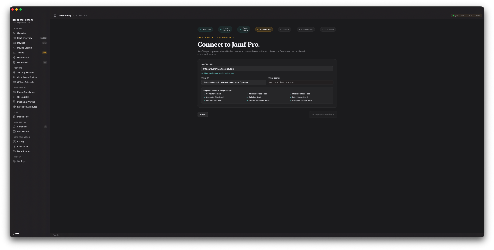

# App Onboarding

The macOS app has a guided first-run flow that takes you from a blank Mac to a first
report. This page walks through it and the workspace it creates.

## Reaching onboarding

On first launch, when jamf-cli has no profiles yet, the app opens a **Welcome chooser** with
four cards:

- **Connect with Jamf Account** — the way
  [jamf-cli's wiki recommends](https://github.com/Jamf-Concepts/jamf-cli/wiki#getting-started)
  to connect Jamf Cloud: a Jamf Account integration scoped to one platform environment,
  through the Jamf Platform API. It starts the Jamf Pro onboarding flow
  with the Authenticate step already on the Jamf Account form.
- **Connect a Jamf Pro server** — the same flow with an OAuth2 API client, for an on-premises
  server, GovCloud or any Jamf Pro instance. The Jamf Platform API gateway is Jamf Cloud only.
- **Connect Jamf School** — starts a Jamf School-only onboarding flow (see
  [Jamf School](https://github.com/tonyyo11/jamf-reports-community/wiki/08-Jamf-School)): the
  same wizard, minus the Jamf Pro Authenticate / Validate / Add-products steps, with a
  dedicated **Connect School** step instead. No Jamf Pro placeholder credentials required.
- **Try the demo first** — loads the fictional "Meridian Health" tenant so you can explore
  every screen before connecting anything. Demo mode is not a real workspace; switch back
  to a real connection anytime from **Settings → jamf-cli → Demo mode**.

Until setup finishes, **Start over** (and **Back** on the first step) returns to the chooser
so you can pick another card. If setup has already created the workspace folder or a jamf-cli
profile, it asks first, then moves that folder to the Trash and removes that profile with
`jamf-cli config remove-profile`, which also deletes its saved credentials. A folder or profile
that existed before setup is never touched. When the profile cannot be removed, setup stays
open and names the command to run. The cards already chose the connection type, so the
Authenticate step does not ask for it again on this path.

After setup finishes the chooser does not reappear. To add more later, open the **workspace
switcher** at the bottom of the sidebar and choose **Add workspace or product…**, or click
**Settings → jamf-cli → Connections → Add connection**. Both open the same **Add** sheet:

- **New workspace**: Jamf Pro (OAuth2), Platform API or Jamf School. **Connect new** starts
  that product's onboarding.
- **Add to** the current workspace: Jamf Protect, on a Jamf Pro or (experimental) Jamf School
  workspace, or a Platform API profile on a Jamf Pro workspace. The Platform API add-on takes a
  profile jamf-cli already has or **Connect new**; either way the app first checks that the
  profile reaches the same Jamf Pro server as the workspace. Jamf Security Cloud is attached
  from **Data Sources**, not here.
- **Profiles jamf-cli already has**: the sheet reads jamf-cli's profiles when it opens and on
  **Re-check**, and lists the ones no workspace uses, including profiles made in Terminal since
  the app started. **Set up workspace** creates the workspace and runs its first collection; a
  Jamf Protect profile is added to the current workspace.

## When jamf-cli is already set up

If jamf-cli already has a profile and no profile has a workspace yet, first launch skips the
Welcome chooser and opens **jamf-cli is already set up**. jamf-cli already holds the
credentials, so this screen covers only what the app is missing. **Use demo data** on the
same screen opens the app on sample data instead.

**Already have a workspace folder?** When the workspace already exists, such as a synced team
folder other Macs use or a folder from a previous install, click **Choose workspace
folder…** and pick the folder that contains the profile folders, not a profile folder
itself. A folder on a sync provider first asks you to confirm that everyone with access to
it can read raw device data. If a workspace for one of your profiles is there, the dashboard
opens on its history and nothing else on this screen runs. That includes the automation
step, so automation stays off until you turn it on in the Automation tab. If none is found,
the screen names the `config.yaml` path it looked for; the folder still becomes the
workspace location, so pick again or initialize below. To add a Mac to a shared workspace,
follow
[Adding another Mac](https://github.com/tonyyo11/jamf-reports-community/wiki/10-Security-and-Operational-Considerations#adding-another-mac).

Otherwise, three steps set up new workspaces:

1. **Environments to set up** — one card per environment, each ticked to start. A Platform
   API profile that reaches the same Jamf Pro server is folded into that environment's card,
   and each Jamf Protect login has a picker for the environment it belongs to. A profile the
   app can't use is listed under **Not set up** with the reason and can't be selected.
2. **Automated scans** — **Keep data fresh automatically** is on by default: a daily collect
   plus a weekly deep scan of the per-device queries. Choose the deep scan and report day,
   how often reports generate (Off, Daily, Weekly or Monthly; Weekly by default) and the
   run time (06:00 by default). The Automation tab changes any of it later.
3. **First collection** — **Initialize & run first collection** creates a workspace for each
   selected profile, then collects for each one in turn, with a live count and a
   per-source list. When at least one workspace was created, **Continue to dashboard** saves
   the automation choice and opens the app; if macOS hasn't allowed the background item, a
   notice says to allow JamfReports under **Login Items › Allow in the Background**. When no
   workspace could be created, the button becomes **Try again** and your choices stay
   editable.

**Skip — set up later from the dashboard** dismisses the screen for good. Overview then shows
a **Configuration incomplete** banner with **Choose existing folder…** and **Initialize**,
and the Automation tab sets up schedules. Unless you skip, the screen comes back whenever no
profile has a workspace, for example after the workspace folder is emptied.

## The onboarding flow

1. **Welcome** — a short intro to what onboarding will do.
2. **Install CLI** — the app looks for `jamf-cli` in `/opt/homebrew/bin`, `/usr/local/bin`
   and the system binary folders, then where Homebrew installed it, and shows the
   `brew install Jamf-Concepts/tap/jamf-cli` command if it finds none. It does not search
   your shell's `PATH`, so a copy anywhere else, such as `~/go/bin`, is not found. See
   [Installation](https://github.com/tonyyo11/jamf-reports-community/wiki/01-Installation) for details.
3. **Workspace** — choose a profile name. The name becomes a folder under
   `~/Jamf-Reports/<profile>/`. Any name works except one with a line break or a space at
   either end; a character a folder name can't hold, such as `/`, is written `%2F` in the
   folder's name. Pick something short like `prod`. `~/Jamf-Reports` is the default location,
   not a fixed one — **Settings → Workspace location** can point it at a shared team
   folder so several Macs build one pooled history; see
   [Security & Operational Considerations](https://github.com/tonyyo11/jamf-reports-community/wiki/10-Security-and-Operational-Considerations)
   before you do, because everyone with access to that folder can read raw device data.
4. **Authenticate** — connect with a Jamf Account integration (Platform API, recommended
   for Jamf Cloud) or with OAuth2 API client credentials (URL, client ID, client secret).
   For a Jamf Account integration, pick your **Region** (United States, Europe or
   Asia-Pacific) and a scope: **Environment** with the environment ID (use this), or
   **Tenant (legacy)** with the tenant ID, which cannot reach Compliance Benchmarks or
   Blueprints. A profile holds one environment; an integration scoped to several needs one
   profile per environment, with the same client ID and secret, and more environments from
   the same integration are added from **Data Sources → Connection → Add environments** after
   setup (see [Adding more environments](#adding-more-environments-from-the-same-integration)).
   jamf-cli suggests keeping a Jamf Pro OAuth profile beside the gateway profile for the
   commands the gateway refuses (device actions among them). Jamf Reports does not run them and
   collects each fleet once: when both reach the same Jamf Pro, setup proposes one workspace,
   named after the OAuth profile, with the Platform API profile as its Platform API profile
   (shown on the environment's card, where **Remove** leaves it out). The secret is passed to `jamf-cli` over a controlling TTY and cleared immediately; the
   app never persists it. Setup has `jamf-cli` store the credentials in the macOS keychain, and
   tokens are cached on disk. An organization-level integration is not accepted: it reaches only Jamf
   Account, so create an environment-level one. For a Platform API connection, create the
   integration in Jamf
   Account first — at the platform environment level, scoped to one environment, with
   read permissions only.
   [Permissions & Access](https://github.com/tonyyo11/jamf-reports-community/wiki/13-Permissions-and-Access)
   has the steps.
5. **Validate** — the app runs `jamf-cli config validate` against the new profile and
   reports success or a redacted error. For a Platform API profile it also checks the
   environment or tenant ID, and setup stops on an ID the gateway rejects or an environment
   with no Jamf Pro (probably a Jamf School tenant; the banner offers **Set up Jamf
   School**); see
   [Check the scope ID](https://github.com/tonyyo11/jamf-reports-community/wiki/13-Permissions-and-Access#check-the-scope-id).
6. **Add products (optional)** — if you use Jamf Protect, connect it here
   (`protect setup`); it augments the Jamf Pro reports. You can also add
   it later from the **Data Sources** screen, where **Disconnect** turns it off again (it
   leaves the jamf-cli profile in jamf-cli). (Jamf School is never added to a Jamf Pro
   workspace; a Jamf School district should instead
   pick **Connect Jamf School** on the Welcome chooser, which runs the dedicated School path
   below — no Jamf Pro placeholder credentials.)
7. **First report** — for Jamf Pro, the app collects a snapshot (refresh and inventory
   data, not the per-device scans) and then generates a first report, so the
   dashboards have data to render; the per-device scans run later on schedule or via
   Collect now on Overview. For Jamf School, this step only generates. If the output
   looks off you can **Skip & finish setup** — the workspace is fully configured at this
   point and you can run reports later from the Reports tab.

   The same step carries two last choices, applied when setup finishes (by the first
   report or by **Skip & finish setup**). **Run automatically** is on by default and is the
   same choice the adopt-existing-profiles screen offers: it turns on managed automation
   (a daily collect, a weekly deep scan and reports on the day and time you pick) and
   registers the background item, so you do not have to open Automation first. Untick it
   to leave automation as it is; an automation setup you already have is never switched off
   or changed. **Webhook (optional)** takes a Teams or Slack incoming-webhook URL; leave it
   empty to skip. Only an `https://` URL is saved, as the workspace's `notify:` block with
   full detail, and you can change it later under Automation › Notifications. Both apply
   when setup was started from demo mode too, since setup creates a real profile.

### Adding more environments from the same integration

A jamf-cli profile holds one environment, so each extra environment of a Jamf Account
integration is its own profile with the same client ID and secret. Once a Platform API
profile is set up, **Data Sources → Connection** lists the connection it belongs to (a
profile in none offers **Start a connection**).

1. Choose **Add environments…**.
2. Paste the environment IDs, one per line, each with an optional label after it
   (`<id> Production`). The label names the new profile and its sidebar entry: the profile
   is `<connection>-<label>` in lowercase letters, digits and hyphens. A name that already
   exists, or differs from an existing profile or workspace only by letter case, is refused
   and shown before anything runs.
3. Type the client ID and secret once, then choose **Register & check**. The app registers
   each profile the way onboarding does (the secret goes over a controlling TTY and is
   cleared when the run ends or the sheet closes) and runs the connection check for each ID.
4. The list shows one result per ID. An environment where Jamf Pro answers gets a workspace
   (with a minimal config.yaml) and joins the connection. An
   environment where no Jamf Pro answers is not added: its MDM is probably Jamf School, which
   is read with a School API key in a Jamf School workspace (the result offers **Add Jamf
   School workspace…**). A rejected or unconfirmed ID is not added either.

The app has no way to remove a jamf-cli profile, so a profile registered for an ID that was
not added stays in jamf-cli; the result names the `jamf-cli config remove-profile` command to
remove it. **Update credentials for all…** re-registers every profile in the connection with
a new secret (each with its own ID) and checks each one. **Rename…** changes the connection
name and member labels, and **Remove** on a member takes it out of the connection without
deleting its jamf-cli profile or workspace. The grouping is kept per Mac, holds no
credentials, and the app never keeps the secret.

### The Jamf School path

Choosing **Connect Jamf School** on the Welcome chooser runs a shorter sequence — Welcome,
Install CLI, Workspace, **Connect School**, First report — skipping the Jamf
Pro Authenticate, Validate, and Add-products steps. Jamf School reports come from jamf-cli.
The Connect School step registers a
`jamf-cli school` profile (School URL + Network ID + API key, passed over stdin and cleared)
and wires `school_cli.enabled`/`profile` into the workspace config, so the first report and
every later collect route to the Jamf School engine. jamf-cli must still be installed to get
past the Install CLI step, but no Jamf Pro credentials are entered. An optional, experimental
switch on the same step, **Do you also have Platform API configured for Jamf School?**, adds
the Platform API region, tenant ID, client ID and secret to the same School profile (never a
profile of its own) and checks them by listing blueprints once. Please
[open an issue or pull request](https://github.com/tonyyo11/jamf-reports-community/issues) if
something looks off. See
[Jamf School](https://github.com/tonyyo11/jamf-reports-community/wiki/08-Jamf-School) for the
full workflow.



## Where data lives

Each workspace is one environment: a Jamf Pro or Jamf School profile and the add-on profiles
(Platform API, Jamf Protect, Jamf Security Cloud) attached to it. Its folder is named for the
Jamf Pro or Jamf School profile, `~/Jamf-Reports/<profile>/` — or under whatever folder
**Settings → Workspace location** points at, if you have moved it:

```text
~/Jamf-Reports/<profile>/
├── config.yaml          # thresholds, security policy, Extension Attributes
├── jamf-cli-data/        # cached JSON snapshots from jamf-cli
├── snapshots/
│   └── summaries/        # summary_<date>.json per day — feeds the Trends screen
├── Generated Reports/    # produced .xlsx / .html / .pdf artifacts
│   └── archive/          # rotated older runs
├── backups/              # jamf-cli backups
└── automation/
    └── logs/             # per-run logs from scheduled runs
```

Everything for one tenant is under one folder. To move a profile to another Mac, copy the
folder and re-authenticate that profile with `jamf-cli platform setup --profile-name <profile>`
(a gateway profile) or `jamf-cli pro setup --url <url> --profile-name <profile>` (an OAuth
profile). Changing the
workspace location does **not** move existing data — copy `config.yaml` and `snapshots/`
across yourself; Config Doctor (Audit → Config) says when more history for a profile is
sitting in the folder you left behind.

## First-run checklist

A quick tick-list for a fresh install. The prebuilt app is an Apple silicon (arm64) build —
on an Intel Mac, build from source instead.

- [ ] macOS 15 or later
- [ ] `jamf-cli` installed (`brew install Jamf-Concepts/tap/jamf-cli`)
- [ ] Jamf Pro URL, API client ID, and secret on hand
- [ ] `JamfReports.app` in `/Applications`, first launch past Gatekeeper
- [ ] Profile created through **Add connection** → New workspace → onboarding
- [ ] Authentication succeeded (Validate step passed)
- [ ] First report generated and opened cleanly
- [ ] `~/Jamf-Reports/<profile>/jamf-cli-data/` contains JSON files

## What the reports need

Reports are built from `jamf-cli` data. The app renders Fleet Overview, Security Posture,
Compliance Posture, Patch Compliance, OS Updates, Policies & Profiles, Extension
Attributes, Mobile Devices, and more — enough for every report template. There is no CSV step
in setup and no CSV report mode (retired in 2.11).

Custom Extension Attribute sheets and security agent coverage come from the Extension
Attribute values jamf-cli collected. After the first collect, open **Extension Attributes → Adopt
EAs…** (or **Data Sources → Adopt EAs**), pick the ones to track and the app adds them to
`config.yaml`. If your tenant has not configured those EAs in Jamf Pro, there is nothing to
adopt. The same sheet can import a Jamf Pro CSV export once to suggest EAs; the file is read
once and only the `config.yaml` entries are kept. See
[Custom EA Examples](https://github.com/tonyyo11/jamf-reports-community/wiki/12-Custom-EA-Examples).

## Running without jamf-cli credentials

Real Jamf Pro credentials are not required to get through onboarding. `jamf-cli` itself
must be **installed** — the Install CLI step won't let you continue until the app finds it
in one of the places that step checks (above) — but installing it is a free Homebrew
download that needs no Jamf Pro server access.

The Authenticate step only checks that the fields are well-formed (a URL plus a client ID
and secret); it does not contact your Jamf Pro server, and registering the profile is a
local `jamf-cli` config write (on jamf-cli 1.29 and later the app passes `--no-verify` to
keep it that way; from a Terminal, add that flag yourself). The Validate step that follows
runs a real connection check and will report failure against placeholder values — but
advancing past it only requires that the profile registered, not that the check passed. So
you can finish onboarding with placeholder Jamf Pro values and add real credentials later.
(A Jamf School-only admin can skip this placeholder workaround entirely by choosing
**Connect Jamf School** on the Welcome chooser.)

To add real credentials later, open **Data Sources → Connection health → Update
credentials…** — it re-registers the profile's jamf-cli credentials (URL, client ID,
and secret) and runs the same connection check onboarding does, without leaving the app.
The same button also appears when the connection-health probe reports an unauthorized or
credentials-unresolved profile. As a Terminal alternative, run this for the same profile
name. Without `--profile-name`, jamf-cli writes a profile called `default` instead of
renewing yours:

```bash
jamf-cli pro setup --url https://your-instance.jamfcloud.com --profile-name <your profile>
```

For a Platform API profile, use `jamf-cli platform setup --profile-name <your profile>`.

This only writes to jamf-cli's own credential store — the app's `config.yaml` and the
rest of the workspace are untouched, so nothing else needs to be redone.

## Next

- [Dashboards](https://github.com/tonyyo11/jamf-reports-community/wiki/03-App-Dashboards) — a tour of every screen.
- [Configuration & Templates](https://github.com/tonyyo11/jamf-reports-community/wiki/04-Configuration-and-Templates) — tune `config.yaml`.
