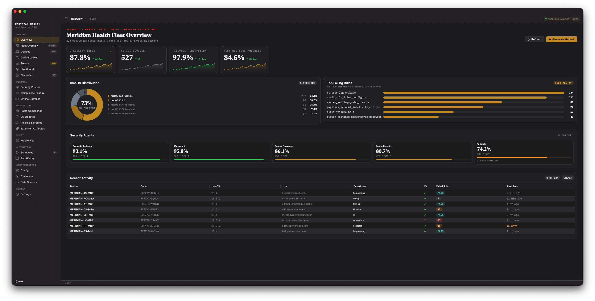
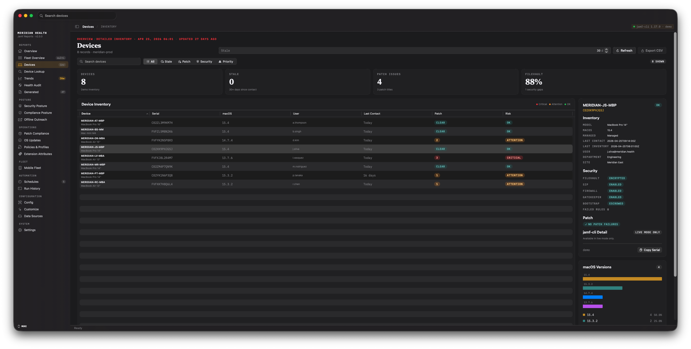
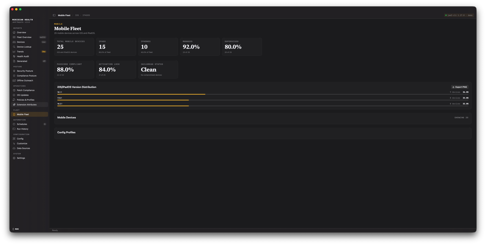
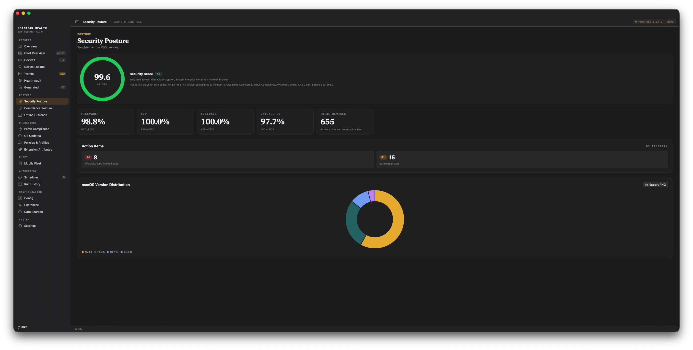
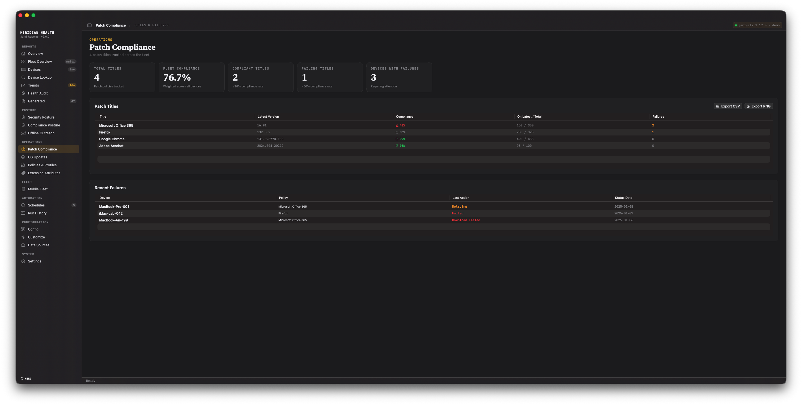

# Dashboards

The app organizes its screens into sidebar groups. This page is a tour of each group.
Every non-core screen can be hidden from **Settings → Sidebar Visibility**; the core
screens (Overview, Computers, Data Sources, Settings) cannot be hidden. The sidebar also
follows the workspace's products: Compliance Benchmarks appears only with a Platform API
profile, Jamf Protect only with Jamf Protect connected, and Mobile Devices only where the
environment has mobile devices. A Jamf School workspace and a Protect-only workspace show a
shorter list.

Most dashboards read cached `jamf-cli` snapshots already on disk — opening a dashboard
does not issue new API calls. Data is refreshed by collection (see
[Scheduling & Automation](https://github.com/tonyyo11/jamf-reports-community/wiki/05-Scheduling-and-Automation)).

A **health strip** sits above whichever screen you are on. It reports data sources that
have stopped collecting or fallen far behind their schedule, and any overdue or failing
schedule, with a **Collect now** action that re-collects just what is behind — so you do
not have to be on Security Posture to learn that security data stopped landing. It also
lists **Needs attention** items: a warning a run logged that you have to act on, such as a
webhook that rejected a card (button: Open Automation), a Jamf Protect backup that was skipped
or incomplete (Open Backups), a Jamf School collect that returned no devices, an unreadable
Extension Attribute snapshot, a large Fleet Drift change or a mobile device list that could
not be saved (each Open Run History). An item clears itself when the next run's check passes;
**Dismiss** hides it on this Mac until it clears and happens again. See
[Automation Trust](https://github.com/tonyyo11/jamf-reports-community/wiki/05b-Automation-Trust).

Every screen on this page reads jamf-cli data. With no jamf-cli connection, or no collect
yet, most of them have nothing to show. See [App Onboarding → Running without jamf-cli credentials](https://github.com/tonyyo11/jamf-reports-community/wiki/02-App-Onboarding#running-without-jamf-cli-credentials) for how a
Jamf School-only setup gets through onboarding. A Jamf School workspace has its own
Overview, Devices and Trends screens and a workbook of its own; see
[Jamf School](https://github.com/tonyyo11/jamf-reports-community/wiki/08-Jamf-School).

## Reports

- **Overview** — the fleet home screen: headline KPIs and score cards (including SIP,
  Firewall and Gatekeeper, chosen with Customize), an OS-distribution donut, top
  failing compliance rules, security-agent coverage, and recent activity. Where the environment has mobile
  devices, a **Mobile Devices** section shows the managed count, the OS-current and passcode
  shares and a Needs attention count that opens the Health Audit; a workspace with no Macs
  leaves the Mac sections out. On a shared
  workspace it also says when another Mac is mid-run, so Refresh appearing to do nothing
  reads as "someone else is working" rather than a bug. On a
  macOS 27+ host with AI insights enabled, an AI Fleet Insight card turns the same daily
  digest into a plain-language summary — see [AI Insights](https://github.com/tonyyo11/jamf-reports-community/wiki/03b-AI-Insights). A banner
  also surfaces when a scheduled run should have fired but didn't — see
  [Automation Trust](https://github.com/tonyyo11/jamf-reports-community/wiki/05b-Automation-Trust).
  Data source: daily summary digest (tier 3) — see [Data Provenance](https://github.com/tonyyo11/jamf-reports-community/wiki/11-Data-Provenance).
- **Fleet Overview** — the workspace selected in the sidebar: its latest summary, issues and
  stability trend. Two workspaces can be different Jamf Pro servers, so their figures are
  never averaged or listed together; switch the workspace in the sidebar to see another.
  Figures across workspaces are in the report-group fleet CSV and workbook.
  Data source: daily summary digest (tier 3).
- **Trends** — historical charts over archived snapshots, including SIP, firewall and
  Gatekeeper lines and, on macOS 27, an AI Trend Insight card that summarises how the
  offered metrics moved over the selected range. See
  [Historical Trends](https://github.com/tonyyo11/jamf-reports-community/wiki/06-Historical-Trends).
  Data source: daily summary digest (tier 3) over time; see Data Provenance for metric
  definitions.
- **Health Audit** — instance health findings plus computer-group hygiene (empty and
  unused smart/static groups). Also hosts the Config Doctor's checks — config drift,
  Alerts rule validation, and Data accuracy (EA parse health, device-count
  reconciliation, EA coverage drift) — see [Diagnostics & Troubleshooting](https://github.com/tonyyo11/jamf-reports-community/wiki/09-Diagnostics-and-Troubleshooting).
  On macOS 27 an AI Audit Insight card suggests which findings to work first and what
  changed since the previous audit.
  A **Mobile Devices** card lists seven mobile findings (jailbroken, unmanaged, passcode not
  compliant, data protection off, OS behind, update errors, stale); each count opens Mobile
  Devices filtered to those devices, and the table's **Needs attention** menu offers the same
  filters.
  Data source: `pro audit` (instance-config checks, fetched by the Run Audit button)
  and group lists (tier 1).
- **Generated** — the library of reports already produced, with **Generate…** (a sheet:
  a template or your own sheets, the formats XLSX, HTML, PDF, CSV and CSV folder (one CSV per workbook tab), whether to collect
  fresh data first, and whether to run a Health Audit first), Export PDF, an inventory CSV
  export, and a **Period report** button that builds a
  start/end/change workbook for a rolling or calendar window — see
  [Period Reports](https://github.com/tonyyo11/jamf-reports-community/wiki/06c-Period-Reports).
  Data source: generated report catalog (no single tier; see [Data Provenance](https://github.com/tonyyo11/jamf-reports-community/wiki/11-Data-Provenance) for report composition).

## Fleet

- **Computers** — the computer inventory table with search, sort, and a Priority Action
  filter. The detail panel shows a per-device risk breakdown. Freshness chips show the
  age of each underlying data source (a red "never" chip flags a kind that's never been
  collected), and a "Collect now" banner appears when the cache is stale.
  FileVault off on a hardware-encrypted Mac reads "Off (hardware-encrypted)" and, under a
  policy that lowers it, adds no risk points. A value Jamf did not collect shows neutral,
  not red.
  Data source: per-device snapshots of computers and mobile-device inventory (tier 1).
  The table shows what jamf-cli collected; a CSV export is no longer merged in.
- **School Devices** (labelled **Devices**) — a Jamf School workspace's devices with
  Managed, Unmanaged and Stale filters and the DEP devices below. Shown only on a Jamf School
  workspace.
  Data source: `school-devices` and `school-dep-devices` (tier 1).

- **Mobile Devices** — iOS/iPadOS device counts, compliance signals, OS-version
  distribution, and a device/profile inventory.
  Data source: `mobile-devices-list` (one fetch with the General, Hardware, Security and
  User and Location sections, tier 1) and profiles (tier 2).
- **Device Lookup** — find one device by serial, hostname, asset tag, or ID.
  Data source: per-device snapshot of computer detail from `pro device <id>` (tier 1).
- **Jamf Protect** — Protect alerts, agent health, and insights. A **Jamf Pro match** card
  shows which Protect computers match a Jamf Pro computer (by hardware UUID or serial
  number, never by name), which have no Jamf Pro record, and which Jamf Pro Macs have no
  Protect record. Shows an explicit
  "Protect not detected" state for tenants that do not run Jamf Protect.
  Data source: Jamf Protect GraphQL API (separate OAuth2 credentials, tier 2).
- **Groups & Searches** — computer and mobile-device group inventory (smart vs. static)
  with each group's member count and description. Empty groups are flagged, and so are
  computer groups no policy or profile uses (from the Health Audit's **Analyze Groups**; mobile
  groups are not analysed), and a summary row also counts policies with no scope. Saved advanced mobile-device searches spell out their
  criteria, and the list is not cut off.
  Data source: Classic API computer/mobile-device group lists (tier 1, same as the group
  lists in Health Audit above), advanced mobile-device searches, and the latest Analyze
  Groups result.

## Posture

- **Security Posture** — a weighted Security Score ring, per-control KPIs (FileVault,
  SIP, firewall, Gatekeeper), prioritized action items, and an OS-version donut, all
  following the workspace's security policy (Config → Scoring): a control set to warning
  is not a P0 or P1 gap, an ignored one is left out, hardware-encrypted Macs with
  FileVault off are counted apart, and Macs that did not report a control are left out
  of its counts with a "not reported: N" note. On macOS 27 an AI Posture Insight card says which
  control to work first. Freshness chips show the age of the underlying data source.
  Data source: `pro report security` (tier 2) aggregates, device inventory and, for the
  hardware rule, the `computers` snapshot (tier 1).
- **Compliance Posture** — a compliance-band distribution donut (Pass / Low / Med-Low /
  Medium / High / No Data), control-coverage gaps, and a per-OS breakdown. When
  `compliance.baselines` configures more than one mSCP/STIG baseline (for example, one per
  OS or one per framework), each baseline gets its own donut; a device whose failure count
  exceeds that baseline's configured rule count is treated as No Data rather than a real
  High band. [Historical Trends](https://github.com/tonyyo11/jamf-reports-community/wiki/06-Historical-Trends) gains a matching baseline picker on
  its compliance-band chart once more than one baseline is configured. Control-coverage
  gaps follow the same policy; the legend under the bars explains warnings and
  not-counted controls. On macOS 27 the AI Posture Insight card also names the macOS
  version that accounts for most of the gap.
  Data source: per-device EA results for mSCP/STIG baselines (tier 1) and device inventory
  (tier 1).
- **Compliance Benchmarks** — per-benchmark compliance rates and device counts from the
  Jamf Platform API. Appears only when the environment has a Platform API profile; the screen shows a locked
  state for a Platform profile at tenant level or one with no data yet.
  Data source: Jamf Platform API `compliance-devices` (tier 1) and device inventory (tier
  1).
- **Offline Outreach** — stale devices bucketed into outreach tiers (31–90 / 91–180 /
  180+ days) by stale age (the oldest date `thresholds.stale_basis` lists, by default the
  check-in) with a one-click clipboard mail-merge of the affected users.
  Data source: per-device last-check-in dates from device-compliance (tier 1) and device
  inventory (tier 1).

## Operations

- **Patch Compliance** — per-title patch compliance with a failures drawer; a "Days
  Behind" column and a Patch Velocity card chart how quickly titles reach adoption once
  released — see [Patch Velocity](https://github.com/tonyyo11/jamf-reports-community/wiki/06b-Patch-Velocity). Freshness chips show the age of
  the underlying data. Exports to CSV and PNG.
  Data source: `pro report patch-status` per-title (tier 2); per-device failures from
  `--scan-failures` (tier 1); title release dates from `pro patch-software-title-configurations
  definitions` (tier 2).
- **OS Updates** — managed software-update plan state, failed plans, and devices in an
  error state. Freshness chips show the age of the underlying data sources.
  Data source: `pro report update-status` plan summaries (tier 2); per-device failures
  from `--scan-failures` (tier 1).
- **DDM Blueprints** — Declarative Device Management status. On any Jamf Pro
  profile: DDM enabled N of M Macs, how many have reported, declarations by
  identifier with the Macs where each is inactive or invalid, and pending or
  failed DDM software updates — all from the weekly per-device scan. On a
  Platform API profile the blueprint deployment sections appear as well. Per-Mac
  detail is in Computers; failed and stuck MDM commands are in Health Audit →
  Command health.
  Data source: per-device `pro declarative-device-management status-items` (`pro ddm-status`
  before jamf-cli 1.29) (tier 1); Jamf Platform API
  blueprint definitions where available (tier 2).
- **Policies & Profiles** — a two-tab screen: policy configuration findings, and
  configuration-profile deployment status.
  Data source: `pro report policy-status` (tier 2) and `pro report profile-status` (tier
  2).
- **Extension Attributes** — a neutral per-EA browser: how many devices report each EA
  (not a coverage percentage — EAs are custom and often legitimately sparse, so the
  screen never grades them against 100%) and top-value distributions. A drift callout
  flags EAs whose device count dropped sharply since the previous collect, comparing an
  EA against its own prior value rather than an absolute target. **Adopt EAs…** lists the
  EAs jamf-cli collected, with a guessed type for each, and adds the ones you pick to
  `config.yaml` as tracked EAs or security agents; it can also import a CSV export once.
  Data source: per-device EA results (tier 1) and device inventory (tier 1).

## Automation

- **Automation** — when the managed automation policy is on, this tab shows a single policy toggle that determines what the bundled background item runs for
  unattended collection and reporting, an Automation Health section (overdue/failing
  schedules), a Notifications section (Teams/Slack webhook configuration), and
  report-group management for consolidated multi-profile reports. When managed
  automation is off, it's the manual schedule editor instead. See
  [Scheduling & Automation](https://github.com/tonyyo11/jamf-reports-community/wiki/05-Scheduling-and-Automation) and
  [Automation Trust](https://github.com/tonyyo11/jamf-reports-community/wiki/05b-Automation-Trust).
  Data source: no tier (configuration and schedule management).
- **Run History** — streamed output from past collect and generate runs, including an
  "Explain this run" AI action on failed runs. A collect you start in the app (the first
  collect, Refresh, the Overview prompt, Collect now) is listed as "Manual collect"; the
  last 20 are kept. One the background item turned away because it was running records
  nothing — see [AI Insights](https://github.com/tonyyo11/jamf-reports-community/wiki/03b-AI-Insights).
  Data source: no tier (local log files, not API data).

## Configuration

- **Config** — the `config.yaml` editor, with a read-only From config.yaml tab for what no
  other tab edits. See
  [Configuration & Templates](https://github.com/tonyyo11/jamf-reports-community/wiki/04-Configuration-and-Templates).
  Data source: no tier (configuration only).
- **Customize** — the chart options generated workbooks use: whether to save chart images,
  and one OS chart per major macOS version, plus a switch to write the HTML report with every
  workbook, and **Percentages**, whether percentages print with one decimal (the default) or as
  whole numbers. The Overview's Generate makes the Full Instance
  report; **Generate…** on Generated Reports, and `jamf-reports generate --template`, make
  the others. Overview score cards
  and sections are chosen on the Overview itself.
  Data source: no tier (user preferences).
- **Data Sources** — the inputs surface: cached `jamf-cli` data, **Adopt EAs**, and
  snapshot status. The **Environment card** at the top lists the products the workspace holds
  (Jamf Pro or Jamf School, Platform API, Jamf Protect) with each one's profile, sign-in
  method and newest data, and a pill when a profile another Mac wrote needs **Confirm** on
  this Mac. **Check**, **Remove** (Platform API and Protect, after a confirmation), **Add** and
  **Change** work per row. **Profiles not in an environment** lists jamf-cli profiles no
  workspace uses; a Jamf Security Cloud login set up in Terminal is attached from there with
  **Add to this environment**. When the login can see only some sites, the card says it sees N
  of M managed computers and reports cover only those.
  **Merging two workspaces:** when a Platform API workspace and a Jamf Pro workspace reach the
  same Jamf Pro server, open the Jamf Pro one and choose **Merge another workspace into this
  one** on the Environment card. The sheet lists what will be copied, what stays as it is and
  any folders read from outside the workspace, then merges. History from both is kept: a file
  only one side has is copied, an identical one is skipped, and when both have a file with the
  same name but different contents the target's stays and the source's goes to an archive. The
  source's profile becomes the target's Platform API profile, and the source folder moves to
  `_merged/<name>-<date>/workspace`, with nothing deleted. If the app quits or a step fails, a
  Resume button on the card continues from where it stopped.
  Data source: no tier (local workspace cache status).
- **Backups** — snapshot and compare Jamf Pro configuration backups. **Diff Selected**
  compares two backups: the **Summary** view collapses objects taking the same change into
  one line, and objects that changed the same field to different values into one card with
  a line each, instead of printing every changed object in full. **Raw** is the whole
  jamf-cli payload, one click away, and **Copy** takes the diff to the clipboard. Summary
  and Copy redact credential-shaped values (password hashes, recovery keys, pre-shared
  keys); Raw is deliberately unredacted, for scripting against. A workspace with Jamf
  Protect connected backs Protect up in the same backup folder (under `protect/`); a banner
  above the table says what the latest backup holds for Protect: object counts per
  resource, or that the Protect part is incomplete, failed or skipped, and why. On shared
  storage, where Protect is skipped by default, the banner explains what a Protect backup
  holds and offers **Back up Jamf Protect in this folder** for organizations whose storage
  policy allows it (`protect.backup_on_synced_storage`). The Jamf Pro part is a choice on
  shared storage too: the same banner holds **Back up Jamf Pro in this folder**
  (`backup.pro_on_synced_storage`). A workspace that already ran scheduled backups there
  keeps backing up for three more scheduled runs while Needs attention asks, then skips Jamf
  Pro until you choose; a new workspace asks before its first backup. Setting it to false
  skips Jamf Pro without marking the run Partial. A backup whose Jamf Pro part was skipped is
  marked in the table and has no diff. Diff
  compares Jamf Pro objects only, and its sheet says Protect is not compared.
  A Jamf School workspace with Jamf Protect shows Backups too and backs up Protect alone.
  Data source: `jamf-cli pro backup` and `jamf-cli protect backup` exports (tier 2).

## System

- **Settings** — app preferences: the jamf-cli install/update check, **App updates** (whether
  Jamf Reports checks GitHub once a day for a new stable release; it never downloads one),
  connections,
  **Workspace location** (point every profile at a shared team folder — see
  [Security & Operational Considerations](https://github.com/tonyyo11/jamf-reports-community/wiki/10-Security-and-Operational-Considerations)),
  diagnostics, and Sidebar Visibility.
  Data source: no tier (app configuration).

## Language

The app is in English, French, Spanish, German, Brazilian Portuguese, Italian and Japanese. It
follows your Mac's language, or the one set for Jamf Reports in System Settings › General ›
Language & Region › Applications. The translations are machine-made and best effort. Reports,
workbooks, logs, webhook cards and the command-line tool stay in English, so a report reads the
same whichever language the person who made it uses.
