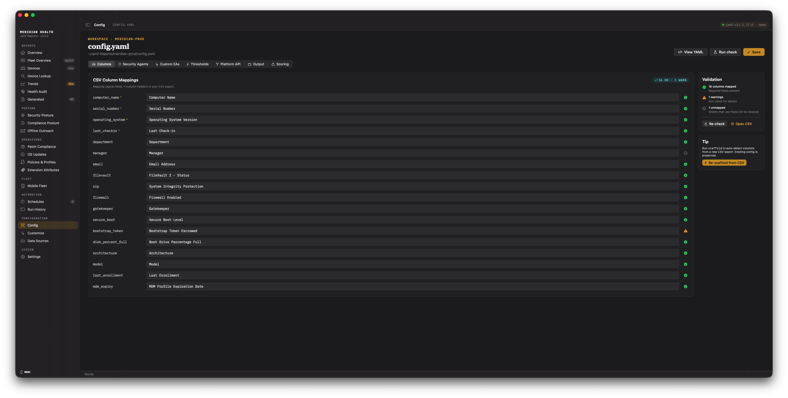

# Configuration & Templates

`config.yaml` is the bridge between your Jamf data shape and the report logic. It maps
your tenant's Extension Attribute names and settings to what the reports track. One `config.yaml` lives in each profile workspace.

The complete, annotated schema is the repo's
[`config.example.yaml`](https://github.com/tonyyo11/jamf-reports-community/blob/main/config.example.yaml).
Treat that file as the reference — the engine ignores unknown keys, so do not invent new
ones.

## How config.yaml is created

- **During onboarding** — creating the workspace writes a minimal `config.yaml` for
  jamf-cli data.
- **Adopt EAs** — on the Extension Attributes screen (and Data Sources), lists the Extension
  Attributes jamf-cli collected, with a guessed type for each, and adds the ones you pick to
  `custom_eas` or `security_agents`. Existing settings are kept. A Jamf Pro CSV export can
  be imported once from the same sheet, or with `jamf-reports scaffold --csv`, to suggest
  EAs; the file is read once and never again.

The result is a starting point, not a final answer. Always review it.

## The Config screen



In the app, the **Config** screen edits `config.yaml` through up to seven tabs. The tabs
offered follow the workspace's products: the Platform API tab appears only when the
environment has a Platform API profile, and a Jamf School or Protect-only environment gets
only Thresholds, Output & Branding and From config.yaml:

| Tab | What it covers |
|---|---|
| Security Agents | third-party agents to track (CrowdStrike, etc.) |
| Custom EAs | extra Extension-Attribute-driven sheets |
| Thresholds | stale-device days, disk-usage and compliance bands |
| Platform API | opt-in Jamf Platform API reporting |
| Output & Branding | output directory, archiving, run retention, report branding |
| Scoring | the Security Policy card and the Security Score's factors and weights |
| From config.yaml | read-only: settings no tab edits, keys the app does not read, lines it skipped |

## Retired column mappings (2.11)

Reports no longer map CSV columns. The `columns` and `mobile_columns` blocks and
`charts.archive_current_csv` are no longer read: Config Doctor lists them as no longer
read, and the next Config save removes `columns` and `mobile_columns` (the next Customize
apply removes `charts.archive_current_csv`) after keeping a dated copy of `config.yaml`. A
`config.yaml` that still has them loads as before. The Config screen's Columns tab is gone.

Key names are exact and case-sensitive. The
[`config.example.yaml`](https://github.com/tonyyo11/jamf-reports-community/blob/main/config.example.yaml)
header comments list every field.

## Tracked sections

Not every config block has a screen in the app. The Config screen's six editing tabs
cover `security_agents`, `custom_eas`, `thresholds`, `platform`, `output`, and
`scoring`; the seventh, **From config.yaml**, is read-only and lists what none of them
edit. `notify` and `ai` each have their own dedicated panel elsewhere in the app
(linked below). `alerts`, `retention`, and `compliance.baselines` are hand-edited in
`config.yaml` directly — there is no editor for them in the app yet, and so are
`shared_workspace` and the two `charts` sub-keys the Customize screen does not cover.
The From config.yaml tab shows all of these read-only.

Hand-editing is safe alongside the GUI: a save from the Config screen rewrites only the
blocks that screen edits and keeps the rest, and scheduled runs read `config.yaml` fresh
at each run — an edit to `alerts:` or `notify:` takes effect on the next scheduled run,
no relaunch required. Inside a block the screen rewrites, comments and lines the app
could not read are not kept: the app copies the file first, and refuses a save when the
file changed on disk after the screen loaded it. See
[A hand-edited config.yaml](#a-hand-edited-configyaml).

- **`security_agents`** — a list of third-party agents. Each entry drives a row in the
  Security Agents sheet. `connected_value` is a case-insensitive substring match; a value
  that says the agent is absent or off ("Not Installed", "not running", "Disconnected") never
  matches, and a blank `connected_value` counts any non-empty value.
- **`sheets`** — `only`, `skip` and `order`, by tab name (case-insensitive), shape every
  report workbook: the Jamf Pro tabs, the custom EA tabs, the Charts tab and Jamf School
  workbooks. The report template picks its sheets first, so `only` never adds a tab; a
  name in both `only` and `skip` is not written; `order` can put a custom EA tab ahead of the
  Jamf Pro tabs; a non-empty `only` drops Charts unless you list "Charts"; an `only` that
  names no tab of the workbook is ignored with a warning. An empty `only: []` means no
  restriction. Period and fleet workbooks do not read these.
- **`thresholds`**, **`output`**, **`charts`** — stale-device window, disk-usage bands,
  output retention, chart toggles. See **Stale Macs and the contact gap** below for the
  stale rule.

### Stale Macs and the contact gap (`thresholds`)

Jamf Pro keeps three dates for a Mac, and each moves for a different reason:

| Date | `stale_basis` word | What moves it |
|---|---|---|
| Last Check-in | `check_in` | the Jamf binary checking in |
| Last Inventory Update | `inventory` | the Jamf binary submitting inventory (recon) |
| Last Contact (Jamf Pro 11.30 and later) | `contact` | any contact: the Jamf binary, MDM or declarative device management |

```yaml
thresholds:
  stale_device_days: 30
  stale_basis: [check_in, inventory]   # optional; default [check_in]
  contact_gap_days: 14                 # optional; default 14
```

A Mac's **stale age** is the largest age, in whole days, among the listed dates it has. It is
stale when that age is more than `stale_device_days`, so a Mac at exactly the threshold is not.
`[check_in, inventory]` therefore means "not checking in or not inventorying beyond 30 days".
A single word reads as a one-item list; a word the app does not know is skipped and named by
Config Doctor, and a list with none uses `[check_in]`. Config › Thresholds has a switch for each
date (at least one stays on).

- A Mac with no check-in or inventory date, in a source that dates every Mac (the `computers`
  snapshot), has never had it and counts as stale. A Mac with no Last Contact is not judged by
  it, and a Mac with none of the listed dates falls back to jamf-cli's own `stale` flag.
- device-compliance rows carry only the check-in day count, so with `inventory` or `contact`
  listed the app reads those dates from the `computers` snapshot, matched by Jamf ID and then
  serial. Without a snapshot, only the check-in counts, and the run log says so.
- The one rule counts the daily summary's stale figure, the Overview, Computers, Offline Outreach
  (its tiers bucket by stale age), the workbook (Active Devices, Compliance Posture, Device
  Compliance, Check-in Health, Patch Summary Dashboard, Executive Summary), the HTML
  report and the Security Score's `checked_in` factor, whose name says which dates it counts. The
  Health Audit's own stale finding stays jamf-cli's. Mobile devices are not covered.

**Contact gap.** A Mac whose Last Contact is current (no more than `stale_device_days` old) while
its Last Check-in is more than `contact_gap_days` before that Last Contact is one MDM reaches and
the Jamf binary does not: broken, removed or blocked. Likewise a Mac whose check-in keeps up but
whose Last Inventory Update lags it. The lag is measured from Last Contact, not from today, and a
Mac silent on every channel is stale, not a gap. A Mac with no Last Contact is left out. The Health
Audit lists both kinds with their Macs and a recommendation, Computers has a **Contact gap** filter
and shows the three dates in the detail panel, the Check-in Health sheet lists the Macs with all
three dates, and the HTML report names both under Needs attention. The daily summary records no
contact-gap count, so there is no Trends series or alert key for it.

### Compliance baselines (`compliance`)

`compliance.failures_count_column` and `compliance.failures_list_column` are the
single-baseline shorthand: an EA column carrying the integer failed-rule count, and an
optional EA column carrying the failed rule IDs, for mSCP/STIG reporting. The IDs are
one per line; a comma, semicolon or pipe also separates them, and a status in place of
a list ("No Baseline Set", "Multiple Baselines Found") marks a Mac that was not
evaluated.

For more than one baseline (an enforced baseline and an audit baseline, or separate
baselines per department), use `compliance.baselines` — a list of
`{name, failures_count_column, failures_list_column, rule_count}` entries. Each
baseline gets its own compliance-band donut and its own Trends band series (see
[Historical Trends](https://github.com/tonyyo11/jamf-reports-community/wiki/06-Historical-Trends)); a baseline picker appears once more than
one is configured. `rule_count`, when set, bounds validity: a failure count above the
baseline's total rule count is treated as bad data (No Data), not banded as a High
failure count. When `baselines` is empty, the app synthesizes a single baseline from
`failures_count_column` + `baseline_label`.

### Security policy (`security_policy`)

By default every security control counts as a gap when it is off. The `security_policy`
block changes that for one workspace, on every screen, report and scheduled run. Each
control, `filevault`, `sip`, `firewall` and `gatekeeper`, is `fail` (a gap: it counts in
the action items, the per-device gap count, risk points and the score, and shows red),
`warning` (shown amber, not a gap, scored as compliant) or `ignore` (not counted at all,
and its score weight is dropped). The percentages themselves, such as FileVault on 94%,
never change; only what the app calls a gap does. You can set it on the **Scoring** tab's
Security Policy card, which saves each change to config.yaml at once and keeps the rest of
the file, or write it by hand:

```yaml
security_policy:
  controls:
    filevault: fail      # fail | warning | ignore
    sip: fail
    firewall: fail
    gatekeeper: fail
  filevault_off_hardware_encrypted: warning
  on_values:             # optional: your own words for on, per control
    firewall: ["Pass", "Compliant"]
  off_values:            # optional: your own words for off, per control
    firewall: ["Fail", "Non-Compliant"]
  score_factors:         # what the score counts; omit for the defaults
    - factor: filevault
      weight: 15
    - factor: agent
      agent: "CrowdStrike Falcon"
      weight: 5
```

**Hardware-encrypted Macs.** An Apple silicon Mac, or an Intel Mac with a T2 chip, always
encrypts its internal disk; with FileVault off the disk simply unlocks without a password.
`filevault_off_hardware_encrypted` sets the level for that case alone (`Same as FileVault`
on the card). Those Macs are named "FileVault off (hardware-encrypted)" and counted apart.
The rule needs the Mac's model details from the latest inventory collect; a Mac whose
record is missing, ambiguous (two records on one serial number) or a virtual machine keeps
FileVault's own level.

**Macs that did not report a control.** A Mac whose value Jamf did not collect for a control
(`NOT_COLLECTED`, a blank, FileVault still encrypting) is not counted as failing it. The Security
Posture, Compliance Posture and Executive Summary figures, the score, the HTML report and the
daily summary count only the Macs measured off, leave the unreported ones out of that control's
share, and say how many there were ("not reported: N", shown only when N is above zero). The
percentages themselves, such as SIP on 1%, still count every Mac.

**Your own on and off values.** The app reads values such as `Enabled`, `Encrypted`, `Off`
and `Not Enabled`. When your organization maps its own extension attribute to
a control and it says something else, such as `Pass` and `Fail` or `Compliant` and
`Non-Compliant`, the app cannot tell whether a Mac passes and counts it as not measured.
List your words under `on_values` and `off_values`, per control (`filevault`, `sip`,
`firewall`, `gatekeeper`), as a list or a single string, and every screen and report reads
them. A value must match whole, in any case, with `-` and `_` read as spaces, so
`Non-Compliant` is not read as `Compliant`. `off_values` is checked first, then `on_values`,
then the built-in words; a value in both lists reads as off. These words apply to each
Mac's own value. The totals that jamf-cli's security report carries (the counts on the
Security Posture screen) keep jamf-cli's words. Health Audit → Config warns about a value that
is not text, an empty value, and a value listed in both.

**Score factors.** The Security Score is the weighted share of Macs that pass each factor.
Config → Scoring lists the factors with today's share, their part of the score and a weight;
remove one, add one from the menu, or use the defaults. The list is saved in the workspace
(`score_factors`), so the Security Posture screen, the Overview, Trends, alerts and reports all
score the same way. Weights need not add up to 100: a factor with no data drops out and the
rest are rescaled.

| Factor | A Mac passes when |
|---|---|
| `filevault`, `sip`, `firewall`, `gatekeeper` | the control is on under this policy (a warning passes) |
| `secure_boot` | Secure Boot is at full security (Macs without Secure Boot are left out) |
| `bootstrap_token` | the bootstrap token is escrowed |
| `os_current` | macOS is at least the newest release of its major version that came out `grace_days` (30) or more days ago, per the SOFA feed |
| `xprotect_current` | XProtect is at the newest version, or that version came out less than `grace_days` (14) ago |
| `patch_compliance` | (per device and title) the device has the title's latest version |
| `checked_in` | every date `thresholds.stale_basis` lists (by default the last check-in) is within `thresholds.stale_device_days` |
| `mscp` | it passes the baseline (`baseline:` names one; default the first) |
| `agent` | the agent (`agent:` names a `security_agents` entry) reports connected, over the whole fleet |

With no list, the score counts the ten native factors (FileVault 15, SIP 10, Firewall 10,
Gatekeeper 5, Secure Boot 5, bootstrap token 5, macOS current 15, XProtect current 5, patch
compliance 10, checked in 5), mSCP at 10 when a baseline is configured, and each security agent
at 5. A control set to `ignore` is not scored. A policy or factor change shows in the daily
summary, and so on the Overview and Trends, from the next collect; the Overview and Trends do
not compare a score with one counted differently.

A level written as `warn`, `failure`, `gap`, `ignored`, `skip` or `not counted` is read,
in any case. A value the app cannot read leaves that control at `fail` (the hardware rule
at FileVault's level); the Scoring card and Health Audit → Config name it and the level used
instead.

### Shared workspaces (`shared_workspace`)

Only relevant when several Macs point at the same workspace folder. It lives in
`config.yaml` — rather than in this Mac's preferences, where the workspace *location*
lives — because every machine sharing the folder has to agree on it:

```yaml
shared_workspace:
  enabled: true                  # omit to decide from the folder itself
  claim_ttl_minutes: 45          # how long a run's claim stays valid (5-720)
  min_collect_interval_hours: 12 # 0 disables the freshness check (max 168)
```

- **`enabled`** is three-state. Leave it out and coordination turns itself on when the
  workspace resolves to a synced folder. Set it explicitly to force it on for a share the
  provider detection does not recognise, or off for a local folder that merely happens to
  sit under a synced path.
- **`claim_ttl_minutes`** (default 45) is how long a run's advertised claim stays valid.
  Floored at 5 minutes so a typo cannot produce a lease that expires before the collect it
  covers, and capped at 720 (12 hours) so a machine that crashed mid-run cannot hold the
  folder for a week.
- **`min_collect_interval_hours`** (default 12) is the window inside which another Mac's
  collect makes this one stand down. `0` disables the check, which is a reasonable choice
  when the machines cover different tenants. Capped at 168 (a week), because one mistyped
  digit in a *shared* file would otherwise stand every Mac down for days with no failure
  to see — only an absence of runs.

Pressing **Refresh** in the app always collects regardless of the freshness window. See
[Security & Operational Considerations](https://github.com/tonyyo11/jamf-reports-community/wiki/10-Security-and-Operational-Considerations)
for the full picture, including what a shared folder costs you in readable device data.

### Metric alerts (`alerts`)

Opt-in threshold alerting, off by default. Each rule in `alerts.rules` names a metric
(`filevault_pct`, `patch_pct`, `stale_count`, the mobile figures such as
`mobile_stale_count`, and similar daily-summary fields), a
comparison (`below`, `above`, or `drops_more_than`), a `threshold`, and — for
`drops_more_than` only — a `lookback_days` (default 7). Rules are evaluated only on
scheduled runs that actually collect fresh data (a `jamf-cli-only` schedule generates
from cache and never evaluates alerts). When a rule trips, one attention card posts to
the `notify` webhook below; a rule with no data that day never fires. A rule with an
unknown metric, an unknown comparison, or a missing/invalid threshold is dropped
rather than breaking the whole config, and shows up as a warning in the Health Audit
screen's Config Doctor. `alerts` has no in-app editor — edit `config.yaml` directly.

### Webhook notifications (`notify`)

Opt-in scheduled-run digest to a Microsoft Teams or Slack incoming webhook:
`enabled`, `provider` (`teams` | `slack`), `url` (must be `https://`), and `detail`
(`full` sends metric values and schedule names; `minimal` sends event facts only —
counts and statuses, no values or free text — for headless or high-security
deployments). `heartbeat: true` (off by default; the Notifications section's **Send a daily heartbeat**
switch writes it) also posts one short "background item ran" card a day per workspace, so a
receiver can alert on a day without one. The card carries the profile and, unless `detail` is
`minimal`, the date of the newest daily summary. Only the background item's own wake sends it;
**Run now** sends none. On a shared workspace a Mac keeps the `heartbeat` value it was set up with until you
confirm a changed one. Unlike `alerts`/`retention`, `notify` has an in-app editor: the
Automation screen's Notifications section (enable toggle, provider picker, URL field,
detail level, and a "Send test notification" button). See
[Automation Trust](https://github.com/tonyyo11/jamf-reports-community/wiki/05b-Automation-Trust).

### Snapshot retention (`retention`)

Off by default — raw `jamf-cli-data/` snapshots are kept indefinitely, since they are
a reporting input (day-over-day and week-over-week history), not just disk cost. When
`enabled: true`: `mode` is `archive` (moves old snapshots to `archive_dir`, still on
disk) or `delete`; `snapshot_keep_days` (default 365, `<= 0` disables the age rule) and
`snapshot_keep_count` (default 0, a floor on newest-N files per kind) both protect a
file — either one keeps it; `include_summaries` (default false) leaves the durable
trend summaries alone unless explicitly set true; `archive_dir` defaults to
`<workspace>/_archive`. `retention` has no in-app editor.

### The environment's profiles (`profiles`)

A workspace is one environment: a Jamf Pro or Jamf School profile plus the add-on profiles
that belong with it. The optional `profiles:` block names them:

```yaml
profiles:
  jamf_pro: "Example"        # the Jamf Pro profile; always this workspace's own
  platform: "Example-API"    # runs the Platform-only reports
  jamf_school: ""            # never together with jamf_pro
  protect: "Example-Protect"
  security_cloud: ""         # a `jamf-cli security setup` login
```

With the block, `jamf_cli.profile`, `protect.*` and `school_cli.*` are no longer read for
profiles; a blank slot is a product the environment does not have. The Jamf Pro or Jamf
School slot must name the workspace itself, so every command runs as the profile the
workspace folder is named for; `jamf_cli.profile` never chooses one. A block with only
`protect` is a Protect-only environment: it collects Jamf Protect alone and refuses every
Jamf Pro command. Jamf Security Cloud is collected after each Jamf Pro or Jamf School
collect and saves only each device's risk category and a few status fields. Without the
block the old keys work as before. On a shared workspace, `profiles.platform`,
`profiles.protect` and `profiles.security_cloud` are held until you **Confirm** them on each
Mac (see
[Security & Operational Considerations](https://github.com/tonyyo11/jamf-reports-community/wiki/10-Security-and-Operational-Considerations)).
The Data Sources **Environment card** edits the slots; Config Doctor checks them
(two MDMs, an unknown profile, a profile shared by two workspaces).

### Backups (`backup`, `protect.backup_on_synced_storage`)

A Jamf Pro backup holds configuration that can contain secrets. On storage other Macs
reach, `backup.pro_on_synced_storage` records your per-workspace choice: `true` backs Jamf Pro
up there, `false` keeps it out, and leaving the key out asks (a workspace that already ran
scheduled backups keeps backing up for three more runs, then skips Jamf Pro until you choose).
`protect.backup_on_synced_storage` is the same choice for Jamf Protect. On a shared workspace
each Mac confirms a `true` once. Local storage needs neither key. The Backups screen
writes both. A Jamf School workspace with Jamf Protect backs up Protect alone.

### Where reports go (`output`, `branding`)

Reports are written to `output.output_dir`, with `~` expanded. A folder outside the
workspace is used only with `output.allow_absolute_paths: true` (`yes`, `on` and `1` also
work; write `true`). A folder the app will not use — outside the workspace without that
setting, or a system or credentials folder — is named in the run log with the reason, and
the report goes to `Generated Reports` in the workspace. The Reports screen lists the
folder in use (and its archive), its header names it, and Reveal in Finder, Open and the
save panels start there. `retention.archive_dir` follows the same rule. `output.keep_latest_runs` below 1 is read as 1. `branding.accent_color`
takes `#RRGGBB` or `#RGB`; anything else uses the default.

`output.csv_folder: true` (default off) also writes one CSV per workbook tab into a
`<workbook name>_csv` folder beside every workbook, including a scheduled run's; the Generate
sheet's **CSV folder** format and `jamf-reports generate --csv-folder` do it for one run.
Every run also writes `<name>.manifest.json`, the size and SHA-256 of each file it made, and
`jamf-reports verify` checks it. `output.timestamp_authority` (default empty) is an `https://`
address of an RFC 3161 time-stamp authority: when set, each manifest's SHA-256 is sent there
and the signed reply is saved as `<name>.tsr`. Nothing else leaves the Mac, a failure is a
warning, and on a shared workspace the address is not used on a Mac until you confirm it
there. See [Command Line](https://github.com/tonyyo11/jamf-reports-community/wiki/07-Command-Line).

### AI insights (`ai`)

Opt-in, and inert on any macOS below 27: `enabled`, `tier` (`on_device`, the
only one), and `reasoning_level`
(`light` | `moderate` | `deep`). Apple Foundation Models is on-device only, so
`on_device` is the default and the only built behaviour.
See [AI Insights](https://github.com/tonyyo11/jamf-reports-community/wiki/03b-AI-Insights) for what the feature does and its in-app Settings
panel.

### jamf-cli collection, cache & integrity (`jamf_cli`)

- **`collect_skip`** (default empty) — report types a collect never runs, a stall guard
  for on-premise Jamf Pro: any of `patch-device-failures`, `profile-status`,
  `update-status`, `update-device-failures` (the per-device-heavy queries known to
  stall a server), `dashboard`, `sofa` (the one fetch from `sofafeed.macadmins.io`,
  for networks that must not reach third-party hosts) and `security-risk` (the Jamf
  Security Cloud device list). Underscores work in place of
  hyphens. Anything else in the list is ignored, so core inventory always runs. A listed
  source is skipped even by a manual collect, the run log says so, and the data
  freshness strip does not wait for it. Skipping SOFA leaves the cached feed in use;
  without cache, the macOS currency score factors have no data.
- **`max_cache_age_hours`** (default 168, one week) — how old a cached snapshot can be
  before the daily summary digest treats it as absent rather than serving it as
  current. `0` (or any value `<= 0`) keeps cache forever. This only affects the daily
  digest path; report sheets still render an older cache with their own "data as of"
  subtitles rather than an empty section.
- **`require_manifest`** — when `true`, every collected snapshot is recorded in a
  per-kind `manifest.json` (SHA-256), and a mismatch or corrupt manifest is surfaced as
  a real finding on the Health Audit screen instead of a neutral "not yet verified"
  line.

## Custom Extension Attribute sheets

`custom_eas` is a list; each entry produces one workbook sheet. Five types:

| Type | Behavior | Key fields |
|---|---|---|
| `boolean` | pass/fail counts | `true_value` |
| `percentage` | color-coded distribution | `warning_threshold`, `critical_threshold` |
| `version` | version distribution | `current_versions` |
| `text` | value frequency table | — |
| `date` | days-until-expiry, color-coded | `warning_days` |

Recipes:

```yaml
custom_eas:
  - name: "FileVault Status"
    column: "FileVault 2 - Status"
    type: boolean
    true_value: "Encrypted"

  # mSCP/STIG failure counts don't belong here — `percentage` is bounded 0-100 and a
  # rule-failure count isn't a percentage. Configure them under `compliance.baselines`
  # instead (see Compliance baselines above) — that's what drives the compliance-band
  # donut and the Trends band series.

  - name: "User Cert Expiry"
    column: "User Certificate - Expiry Date"
    type: date
    warning_days: 30
```

```yaml
security_agents:
  - name: "CrowdStrike Falcon"
    column: "CrowdStrike Falcon - Status"
    connected_value: "Installed"
```

After editing, open the **Health Audit** screen — each Custom EA is listed with its
column name and detected type, and any column missing from the cached data is flagged.

## The Customize screen

The **Customize** screen holds the report options that are not in Config:

- Two chart switches, saved per profile when you press Apply:
  **Save PNGs alongside xlsx** (`charts.save_png`) and **Per-major macOS charts**
  (`charts.os_adoption.per_major_charts`).
- **Percentages** (`display.percent_decimals`, saved with Apply): `56.7%` (one decimal, the
  default) or `57%` (whole numbers). Every screen, workbook, CSV folder, HTML report, period
  report, alert card and on-device insight follows it. Rounding is to the nearest step, and a
  share above 0% or below 100% never prints as 0% or 100%. Stored figures, thresholds and
  alerts keep full precision; workbook number cells keep the full value and only display it
  rounded. A figure printed beside the threshold it missed keeps one more decimal, so 89.6%
  never reads "90% (below 90%)". Changes read as whole percentage points at `57%`, and a
  change that rounds to nothing reads "No change". The cross-workspace fleet reports keep
  one decimal.
- **Write the HTML report with every workbook** (`html.with_workbook`, saved with Apply
  too): when on, each run that writes a profile's workbook also writes that profile's HTML
  report beside it, with the same name and a `.html` extension and the same template's
  sections. It covers the Generate buttons, scheduled runs that generate, and
  `jamf-reports generate`. It does not cover the fleet and period workbooks, or Jamf
  School workbooks, which have no HTML report. Choosing HTML as a format in **Generate…**
  writes that one HTML report, not a second. If the HTML report cannot be written, the
  workbook is kept and the run log gets one `[warn] HTML report not written` line; the run
  is not marked Partial. When older runs are archived (`output.keep_latest_runs`), a
  workbook's HTML report moves to the archive with it and does not count as a run of its own;
  an HTML report with no workbook of the same name, such as the one **Generate…** writes
  when you choose HTML as a format, or `jamf-reports html` output, stays where it is. It is
  off by default.
- A button to the Overview's own **Customize** sheet, where you choose which score cards and
  sections the Overview shows.
- How to get a shorter workbook: choose a template or your own sheets with **Generate…** on
  Generated Reports, or use the command-line tool's `--template` (see Report templates
  below).

Before 2.8.1 the screen also had a grid of sheet toggles, an Executive preset and three more
chart switches. Nothing saved them or read them when generating, so they are gone. The
stale-device trend (`charts.device_state_trend.enabled`) and the mSCP/STIG band trend
(`charts.compliance_trend.enabled: false` leaves it out) are set in `config.yaml`. Before 2.10
the compliance bands (`charts.compliance_trend.bands`) drove a separate Compliance Band
Distribution chart that never showed device counts; it is gone, and `bands` is no longer read.

Both chart switches default to on, and the report reads a missing key the same way, so a
workspace with no `charts:` block gets the OS adoption chart and the PNG files. A workspace
that wants no OS adoption chart sets `charts.os_adoption.per_major_charts: false`.
`save_png: false` now genuinely stops standalone PNG files being written
beside the workbook — before 2.7.0 the setting was read by nothing and PNGs were always
written. Charts *embedded in* the workbook are governed separately by
`charts.embed_in_xlsx`.

## A hand-edited config.yaml

The app reads config.yaml the way you wrote it. Two-, three- and four-space indentation,
or a mix, all read the same; a key typed twice reads as its last value everywhere; a list
item written as a bare `-` with its contents underneath works. What it cannot read it
says, by line number, on the Config screen and in Config Doctor: a line indented differently
from its neighbours, a line with no `key: value`, a tab in the indentation, a `|` or `>`
block value, a list not closed on its line, a `---` second document. Config Doctor also lists
every key the app does not read, with the key you probably meant (`os_version` for
`operating_system`), and says when a value you typed was replaced, clamped or ignored, so
a hand-typed setting is never changed in silence. It never prints a value that could be a
URL or secret.

The **From config.yaml** tab shows the same things read-only: the settings no other tab
edits (your `alerts`, `retention`, `shared_workspace`, `compliance.baselines`), the keys
the app does not read, and the skipped lines. Reload re-reads the file; the other tabs
keep what they loaded. Anything that looks like a URL, token or password shows `(set)`.

**Saving.** A save from the Config screen rewrites only the blocks that screen edits. It
keeps the blank lines and comments between blocks, keys the screen does not show on an
agent or custom EA, and keys typed in the Notifications and AI blocks. Comments and lines
the app could not read *inside* a block the screen rewrites are not kept; before such a
save the app copies the file to `config.yaml.bak-<date-time>` beside it (the newest five
are kept) and says where. If config.yaml changed on disk after the screen loaded it, the
save is refused and the screen offers Reload. A `custom_eas` or `security_agents` block
that is not a list is left as typed. Onboarding and `jamf-reports scaffold --out` copy an
existing config.yaml the same way before replacing it.

## Checking your config

**Health Audit → Config** (Config Doctor) runs every validation the app has — not just
"does `config.yaml` parse". It reports baselines pointing at
extension attributes nobody collects, tracked extension attributes with no collected values, malformed alert rules, data-accuracy problems, and
the state of the workspace folder, each with a concrete fix. On a shared workspace it also
reports the other Macs writing there. It also lists every key the app does not read, with the
nearest known key, each line it skipped, each typed value it replaced or clamped, and the
keys it reads that nothing uses.

Two of its findings are about a workspace that is fine but not the one you expected: it
says when **more history for this profile exists in another folder** (naming it and how
much is there), and when **a workspace is new**, so thresholds and tracked extension attributes are
defaults rather than something you set. Both are suggestions, not failures, and both stay
quiet once the workspace has history.

The same checks run headlessly as `jamf-reports check` — see
[Command Line](https://github.com/tonyyo11/jamf-reports-community/wiki/07-Command-Line).
A scheduled run records any *failing* check in its own log, so a run that collects happily
against a broken config no longer looks clean in Run History.

## Report templates

The app ships report templates, each a curated sheet selection rather than a separate
engine. The Overview generates the Full Instance report, with every sheet. **Generate…** on
Generated Reports generates any template, or a custom set of sheets;
`jamf-reports generate --profile <profile> --template executive` generates the same
templates (see
[Command Line](https://github.com/tonyyo11/jamf-reports-community/wiki/07-Command-Line)).
All formats — XLSX, HTML, PDF — are produced by the native Swift engine.

**Generate…** opens a sheet where you choose a template (Full Instance, Executive,
Operational, Compliance, Asset, Security Posture, School) or **Custom**, any sheets you
tick (your choice is remembered), the formats (XLSX, HTML, PDF, CSV, CSV folder), whether to collect
fresh data first (off by default when your data is under an hour old) and whether to run a
Health Audit first. It replaces the old Generate HTML button, and it has no schedule form:
use Automation for that.

| Template | Audience | Cadence | Focus |
|---|---|---|---|
| Executive | Leadership | Monthly | One-screen story: managed devices, encryption, patch posture, OS adoption |
| Operational | Fleet ops | Daily | Actionable failures and intervention queues |
| Compliance | Auditors | Monthly | Jamf state tied to mSCP baselines and compliance bands |
| Asset | Asset / lifecycle | Quarterly | Hardware inventory and refresh planning |
| Security Posture | Security review | Weekly | Managed controls, security agents, EA-derived signals |

To change a template's sheet selection permanently, edit its file under
`app/Sources/JamfReports/Engine/Templates/` and rebuild — that is a code change, not a
config change.

### The HTML report

The HTML report is written to be read from the top and to stop reading wherever you have
enough. From the top it has:

1. **A header** with the profile, when the data was collected, the jamf-cli version, how
   many Macs, the template and the reporting week. A fact the app does not have is left
   out, not printed as a dash.
2. **At a glance**: six figures (security score, P0 security gaps, patch compliance, Macs on
   the current macOS, stale Macs and compliance), each with its change since the daily
   summary about a week earlier, worded as the Trends screen words it: percentage points for
   a share, a signed whole number for a count, "better" or "worse" by which way is good, and
   "No change" when it rounds to nothing. A figure the earlier summary measured another way
   (patch compliance before 2.9, or a compliance proxy against a benchmark) says so instead
   of showing a change.
3. **Needs attention**: one sentence for each of stale Macs (more than
   `thresholds.stale_device_days` days without a date `thresholds.stale_basis` lists), Macs MDM
   reaches whose Jamf binary or inventory lags (the contact gap), P0 gaps, patch titles under 50%, failing configuration
   profiles and apps, failed patch or update runs, and security agents not on every Mac. A
   sentence appears only while its count is above zero and links to the part of the report
   that lists it; opening a link opens the group around it. The stale figure and its sentence
   come from the daily summary, which includes Macs enrolled without the Jamf binary; they say
   how many ("includes 2 without the Jamf binary, listed apart"). The security agents line
   links to Security agent health, which lists the Macs missing each agent.
4. **The jamf-cli dashboard**, open, when one was collected (jamf-cli 1.31.0 or later). With it
   in the report, the report leaves out the three sections it repeats: the OS version
   distribution, the audit findings and the catalog counts. Without it, those are in the
   report.
5. **Detail groups, collapsed**: Security and compliance, Patching, Devices needing
   intervention, Policies and profiles, Trends, Recent failures, Breakdowns and Mobile
   devices (counts, management, passcode and Activation Lock, iOS and iPadOS versions; no
   device list; in the Full Instance and Asset templates). Each group's
   one-line heading carries its numbers ("Patching — 118 titles behind · 12 under 50%").
   Lists show ten rows; the rest are behind "Show all". Healthy profiles are counted, not
   listed. **Expand all** and **Collapse all** (top right) open and close everything. A
   section with nothing to show is not drawn.
6. **The audit appendix**, collapsed: each data source with its snapshot date, what every
   figure means, the `security_policy` in force (levels other than Fail, the hardware rule
   and the score factors) and a list of what the report leaves out and why: empty, not
   configured, shown in the dashboard, or the device inventory.

Printing opens every group first, and the PDF export is written with every group open. The
report carries no full device list, because a report is forwarded; the workbook has the
inventory. The lists it does carry are action lists: Macs past the check-in threshold,
recent failures and the devices with the most compliance failures.

The template decides how much of that you get and what starts open:

| Template | In the HTML report | Starts open |
|---|---|---|
| Executive | Header, figures, attention list, dashboard, appendix; no detail groups | n/a |
| Operational | Everything it lists | Computers needing intervention, Patching, Recent failures |
| Compliance | Everything it lists | Security and compliance |
| Security Posture | Everything it lists | Security and compliance |
| Full Instance | Every section | Nothing |

## Platform API

Blueprint status, DDM status reports and the Compliance Benchmarks sheets come from reports
only the Jamf Platform API serves. Collect runs them as the workspace's Platform API profile:
the profile named in `profiles.platform` when the config has a `profiles:` block (no slot
means they are skipped), otherwise the workspace's own profile when its auth method is
`platform`. A tenant-level profile (`--tenant-id`) skips Compliance Benchmarks and blueprint
status, which Jamf Account does not grant at that level. The workbook adds the sheets
whenever those snapshots exist.

The Compliance Benchmarks and DDM Blueprints screens do not share one test. Compliance
Benchmarks and the blueprint sections need a Platform API profile; the DDM screen works on
any profile, from the per-device scan or from inventory saying DDM is enabled. The
Platform API left Settings → Experimental Features when it became a supported connection;
a leftover stored opt-in is ignored.

Those are the only gates. There is no `platform.enabled` setting (a Config screen switch of
that name changed nothing and was removed in 2.9), and
`experimental.platform_features_enabled`, which earlier versions of this page listed, does
not exist.
