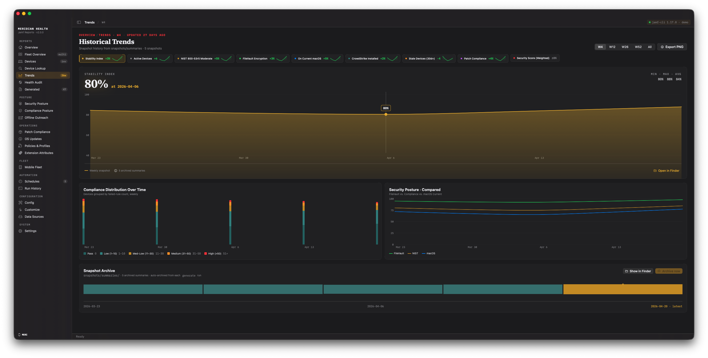

# Historical Trends

Jamf Pro shows you current state. A reporting program needs point-in-time history. The
project's model is simple: save a snapshot every run, then build timelines from those
snapshots later. Jamf will not reconstruct past state for you on demand.

## The Trends screen



The app's **Trends** screen plots fleet metrics over time — compliance, FileVault, SIP,
firewall and Gatekeeper rates, patch posture, device counts, and a weighted stability
index. A metric picker switches the hero chart; comparison charts stack compliance bands
and overlay multiple series.

Patch compliance is the share of devices on the latest version. Days recorded before 2.9
used a per-title average; where the daily patch snapshots exist the app works those days
out again, so the line does not step at the upgrade.

The trend range defaults to four weeks and is configurable in **Settings → Data &
Charts** (up to roughly a year of history, or **All**).

Title-level patch adoption speed (days to 50%/90% adoption after a release) is a
separate view on the Patch screen, not a Trends metric; see
[Patch Velocity](https://github.com/tonyyo11/jamf-reports-community/wiki/06b-Patch-Velocity).

Trends is for looking. When you need the same history as *figures to quote* — a start, an
end, and the change over a quarter or any other window — generate a
[period report](https://github.com/tonyyo11/jamf-reports-community/wiki/06c-Period-Reports)
from the Generated screen instead. It reads the same daily summary files described
below, plus your collected extension attributes.

## Mobile devices

When the workspace has mobile devices, Trends also offers their series: managed, supervised,
stale (last inventory on Jamf Pro, last check-in on Jamf School) and on the current OS, plus
passcode compliant, data protection and jailbreaks where Jamf Pro reports them. Macs and mobile
devices are never added together into one figure. A figure the product does not report is left
out, not drawn as 0. Each share is counted over the devices that report the field.

The Macs series is **Managed Computers** (it was Managed Devices): its figure and chart count
Macs only, and mobile devices have their own **Managed mobile devices** series. Device-count
charts scale to the data, so a small fleet no longer sits flat at the bottom of a 0 to 1,000
axis. Alert rules can watch the mobile figures too; the metric names are in
`config.example.yaml` under `alerts`.

## Jamf Protect and Security Cloud

Where the environment has them, Trends also offers Jamf Protect series (computers, the share
matched to inventory, open alerts) and Jamf Security Cloud series (devices, matched share,
high-risk devices). A Protect-only workspace keeps the Trends tab with the Protect figures only.

## Compliance band history

When `compliance.baselines` (see [Configuration & Templates](https://github.com/tonyyo11/jamf-reports-community/wiki/04-Configuration-and-Templates))
configures more than one mSCP/STIG baseline, the compliance band chart shows a
baseline picker — each baseline keeps its own independent band series, and counts are
never summed across frameworks.

Some `ea-results` snapshot files are recovered from a truncated download rather than
decoded whole. A day recovered this way is marked on the band chart with a warning
triangle and a caption explaining it, so a partially-recovered day is never read as a
real change in fleet compliance. Salvaged days are also excluded from the Extension
Attributes screen's coverage-drift comparison for the same reason — a truncated
snapshot would otherwise look like a genuine coverage drop.

## Daily summary files

Every collect or generate run writes one `summary_<date>.json` file to:

```
~/Jamf-Reports/<profile>/snapshots/summaries/
```

(The `snapshots` part follows `charts.historical_csv_dir`.)

Each file is a per-day aggregate — date, total devices, compliance percentage, FileVault
percentage, patch percentage, and related metrics. The Trends screen reads this directory;
one file equals one point on the timeline. The first run of a given day writes that day's
summary; a later run the same day replaces it only when it measured a source the first run could not. See [Data Provenance](https://github.com/tonyyo11/jamf-reports-community/wiki/11-Data-Provenance)
for details on where each metric comes from.

Because the cadence determines the granularity, **build the collection cadence first**
(see [Scheduling & Automation](https://github.com/tonyyo11/jamf-reports-community/wiki/05-Scheduling-and-Automation)). Weekly collection produces
weekly trend points; irregular collection produces irregular timelines.

## Two historical stores

Trend data uses two on-disk stores, kept separate on purpose:

- **Daily summaries** (`snapshots/summaries/`) — one `summary_<date>.json` per day. The
  Trends screen is built from these. Since 2.11 nothing reads or writes dated CSV exports
  here (`archive_current_csv` is retired).
- **jamf-cli JSON history** (`jamf-cli-data/`) — cached API responses. The trend source
  for API-native summaries: OS adoption from `inventory-summary`, device-state trend from
  `device-compliance`, security posture from `security`.

The app's Trends screen reads these daily summary files. Treat `snapshots/`
and `jamf-cli-data/` as append-only — generated workbooks and PNGs are disposable output,
not the historical record.

## HTML report timeline

The self-contained HTML report has a **Trends** group: a chart of FileVault, SIP and
compliance from the daily summaries, with the daily values in a block of their own under
"Daily values". With `html.track_history: true` the group also appends each run's OS-version
snapshot to the history file and draws the OS adoption trend once two or more snapshots
exist for the same instance.
